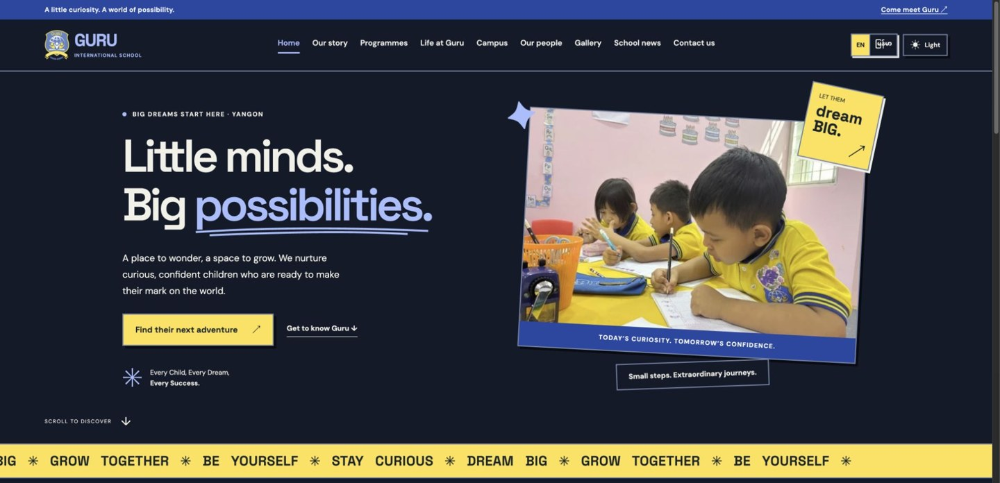
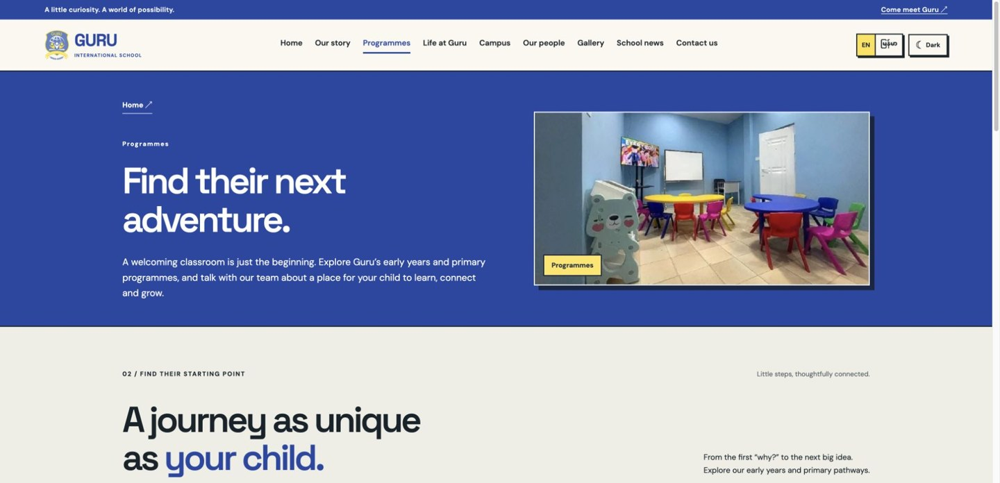
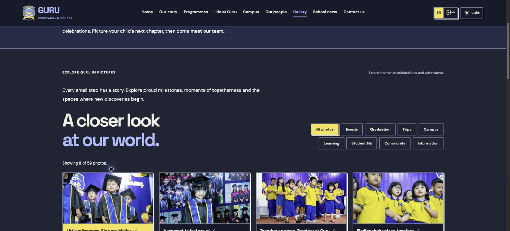
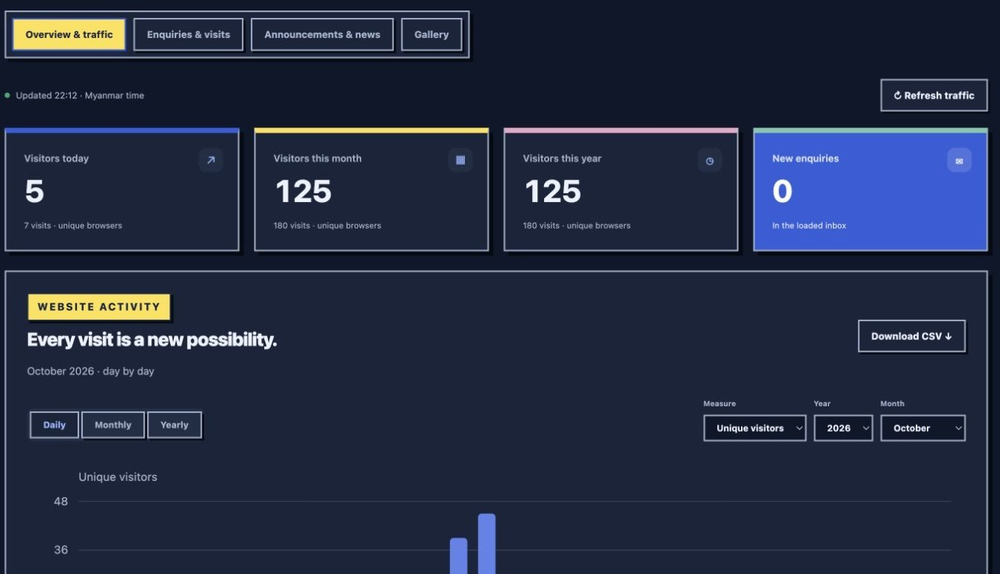
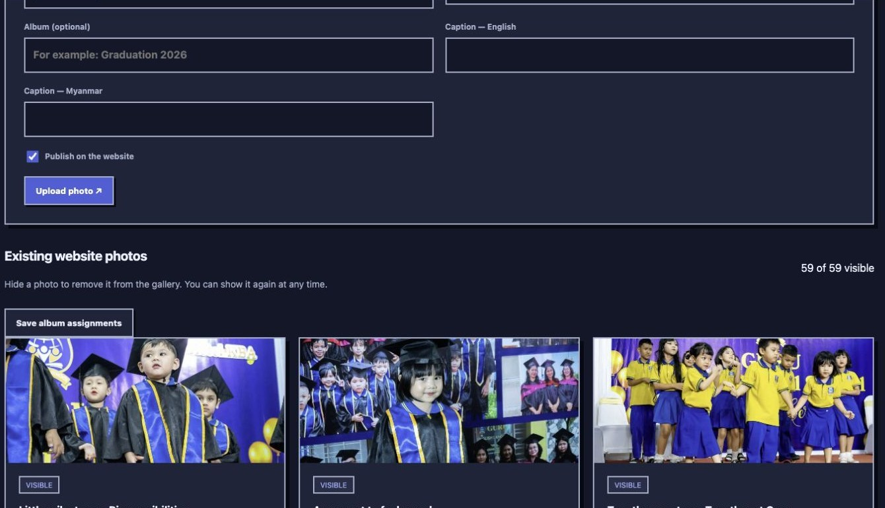

# Guru International School — Dynamic React website

A multi-page school website and staff dashboard for **Guru International School, San Chaung, Yangon**, designed and developed by **Win Min Thaw (Moosey)**.

**[Visit the live website ↗](https://www.guru-school.org/)** · [Programmes](https://www.guru-school.org/programmes) · [Gallery](https://www.guru-school.org/gallery) · [Contact](https://www.guru-school.org/contact)

The public site helps families explore the school, programmes, people and community. The authenticated staff dashboard manages enquiries, announcements, news, gallery content and approximate visitor activity. The frontend uses **React with JSX and Vite**; **Node.js Vercel Functions**, private Blob storage and SMTP provide the dynamic services.

## Visual highlights

Reference captures from the production website and staff interface, 20 October 2026. Screenshots show a point in time; published content and traffic values can change. Staff captures omit account identifiers and family records.

### A welcoming public website



The navy, cream and yellow identity carries through separate page URLs, school imagery, large headings and direct links to explore or enquire. English/Myanmar language controls and light/dark appearance controls are available across the site.

### Programmes with a clear next step



Families can explore early years, lower primary and upper primary pathways, then contact the school about the appropriate programme and current availability.

### School life through photographs



Category and album filters organize events, graduation, trips, campus and other school moments. Visitors can reveal more photos and open a focused image viewer with captions and keyboard dismissal.

### A practical traffic dashboard



Staff can compare anonymous browser activity by day, month or year and export traffic data as CSV. These are approximate browser counts, not a count of identified people. Screenshot values are historical examples from the actual interface.

### Photo management for staff



The school team can add photos, choose categories and albums, write captions and show or hide existing website photos through the dashboard.

## Public features

| Area | What visitors can do |
| --- | --- |
| Home and school story | Discover the school’s identity, values and approach. |
| Programmes | Explore early years and primary pathways and follow direct enquiry links. |
| Life, campus and people | Browse the school environment, daily activities and leadership profiles. |
| Gallery | Filter categories/albums, reveal additional photos and open captioned images. |
| News | Read published school stories; drafts and future-scheduled stories remain private until due. |
| Contact and visits | Send an enquiry, discuss a programme, leave a short message or request a preferred visit date. Visits require school confirmation. |
| Language and appearance | Choose English/Myanmar and light/dark mode. Some descriptions use English fallback where a Myanmar translation is unavailable. |
| Footer | Access school contact links, Facebook, privacy information and back-to-top navigation. |
| Search discovery | Public pages have initial HTML, titles, descriptions, canonical URLs and social preview metadata; sitemap and robots files support discovery. |

## Staff dashboard

| Workspace | Main capabilities |
| --- | --- |
| Overview & traffic | Daily/monthly/yearly views, visitor/visit measures, period selection and CSV export. |
| Enquiries & visits | Search and filter messages, review contact details, keep private notes and follow-up dates, update status, open an email reply and delete messages with confirmation. |
| Announcements & news | Edit the announcement ribbon, maintain English/Myanmar fields, add news text and optional images, save drafts and schedule publication in Myanmar time. |
| Gallery | Upload images, add bilingual captions, choose categories/albums and manage public visibility. |
| Sign-in and preferences | Password plus production email verification code, staff sign-out, English/Myanmar controls and light/dark dashboard appearance. |

The dashboard has four content workspaces. Calendar and backup-management tabs are not part of the current interface. Admin access is protected by server authentication; hiding an admin link is not the security boundary.

## Architecture at a glance

```text
React public website + staff dashboard
                │ HTTPS / JSON
                ▼
       Node.js Vercel Functions
          ├── Private Blob storage: content, enquiries, sessions, traffic
          └── SMTP: sign-in codes, school notifications, visitor acknowledgements
```

- Public pages are pre-rendered at build time, then hydrated by React.
- Dynamic content is fetched through the API; staff writes require authentication and request validation.
- Enquiries are saved privately before notification email delivery is attempted.
- The public contact address and configured school inbox are `guruinternationalschool.aca@gmail.com`.
- Server secrets belong in local private environment files and Vercel settings, never frontend code or Git.

## Current update summary

- Production domain: **https://www.guru-school.org/**.
- Public contact and administrative sign-in email configuration use the school Gmail account; actual SMTP credentials stay outside the repository.
- Square school-logo favicons are supplied for browser and touch-icon use.
- Updated school photos, captions, gallery categories and staff visibility controls are included.
- Dedicated public routes, theme/language controls, dynamic publishing, enquiries and analytics are part of this source tree.
- This repository is the school application. The separate Moosey portfolio is maintained in `moosey-sys/moosey-portfolio`.

## Technical and operational guide

The following sections explain local development, deployment, private configuration, privacy and validation in more detail.

## Run locally

The project now lives directly in `Guru-Project-Website/`; there is no nested `guru-school/` folder. Open that folder in your editor and run commands from it.

Use Node.js 24 (matching `package.json` and the deployment runtime), then:

```sh
npm ci
npm run dev
```

The Vite website opens at `http://localhost:5173` and proxies `/api` to the local Node server on port 5175. The development API requires the private `.env` and `.env.local` files. Staff cookies use Secure and HttpOnly; use the deployed HTTPS dashboard for production authentication checks.

```sh
npm run check       # Backend and tooling syntax
npm run build       # Client bundles, React pre-rendering, output security checks
npm test            # Node backend tests and React UI tests
npm run preview     # Serve the production build locally
```

## Source layout

- `src/PublicApp.jsx`: public pages, navigation, published content and visitor tracking.
- `src/AdminApp.jsx`: authentication and staff workspace.
- `src/components/`: gallery, photo viewer, enquiry form, publishing editors, inbox and analytics charts.
- `src/content/SchoolSections.jsx`: existing school content as editable React components.
- `src/content/pages.js`, `gallery.js`, `translations.js`: page metadata, gallery photos and Myanmar translations.
- `src/styles.css`, `admin.css`: original visual systems, with small contrast improvements.
- `src/palette.mjs`: checked semantic colour pairs and contrast calculation.
- `public/assets/`: all original and updated school images.
- `api/`, `lib/`: private storage, sessions, SMTP mail, publishing and visitor analytics.
- `scripts/prerender.mjs`: writes initial React HTML for each public page. `dist/` and `.build-server/` are generated and ignored by Git.

Edit `src/` and `public/`, then build. Do not edit generated files in `dist/`.

The older showcase project, source-photo duplicates, preview screenshots and one-time image preparation scripts are no longer part of the active project. The website uses the prepared images in `public/assets/`.

## Pages and deployment

Routes are `/`, `/about`, `/programmes`, `/life`, `/campus`, `/team`, `/gallery`, `/news`, `/contact`, `/privacy.html` and `/admin`. Each public page is pre-rendered for fast initial loading and search engines, then React hydrates its controls. Navigation retains separate page URLs and normal browser back/forward behaviour. Legacy links such as `/#gallery` redirect to the related page.

Vercel runs `npm run build` and serves `dist/`, with existing page rewrites and Node API functions. The primary production URL is `https://www.guru-school.org/`; `https://guru-school.vercel.app` is the Vercel alias. The source repository is `https://github.com/moosey-sys/guru-school`. DNS/domain settings and private environment variables are managed separately from Git.

## Private configuration

Required server variables: `BLOB_READ_WRITE_TOKEN`, `ADMIN_USERNAME`, `ADMIN_PASSWORD_HASH`, `SESSION_SECRET`.

Production sign-in and email delivery require the mail variables: `SMTP_HOST`, `SMTP_PORT` (465 or 587), `SMTP_USER`, `SMTP_PASS`, `MAIL_FROM`, `MAIL_TO`. The public contact address, enquiry notification recipient and `ADMIN_2FA_EMAIL` sign-in code destination are `guruinternationalschool.aca@gmail.com`. The sender is the authenticated SMTP account; Reply-To is the visitor's email. Sending from the school Gmail account requires its own `SMTP_USER`, `SMTP_PASS` App Password and matching `MAIL_FROM`. For Gmail use a Google-generated App Password for the sending account, not its normal password. The receiving inbox does not need an App Password.

Enquiries are saved privately before SMTP delivery is attempted. Missing or failed SMTP does not lose the message. The staff inbox shows `not-configured`, `accepted` or `failed`; SMTP acceptance is not proof of inbox delivery. Visit requests require school confirmation, and changing their status does not automatically send a booking email. Parents receive a separate acknowledgement email after their enquiry is saved; email failures are tracked without discarding the enquiry.

Never commit `.env`, `.env.local`, `.admin-credentials`, private keys or tokens. Those files are ignored by Git and excluded from deployment uploads. Authentication uses a salted scrypt hash, signed secure cookies, origin validation, CSRF checks and rate limits. Conditional ETag writes protect staff edits from overwriting each other. Draft stories and unpublished uploads are private. Uploaded JPEG/PNG/WebP photos are decoded, stripped of metadata and re-encoded to WebP.

## Visitor statistics

Daily, monthly and yearly statistics use Myanmar time (`Asia/Yangon`). Visitors are approximate distinct browsers, not identified people. An anonymous browser ID lasts up to one year and visits last 30 minutes. Reloads and navigation remain in the same visit. Different devices or cleared cookies can count separately. Signed-in staff, obvious bots, Do Not Track and Global Privacy Control requests are excluded. No raw IP addresses, names, emails or browsing history are stored in traffic events. Statistics start when tracking was introduced; earlier traffic cannot be reconstructed. The report explicitly fails rather than silently truncating above 100,000 event markers.

## Migration verification

The test suites cover public navigation, language/theme persistence, gallery filtering/expansion and photo viewing, campus filters, public news visibility, visitor privacy preferences, enquiry booking fields, submission/error handling, staff login/logout, analytics views, publishing and stale-version errors, photo upload/save, inbox notes/status, authentication/CSRF/origin checks, image validation, SMTP success/failure, durable enquiry storage, anonymous statistics and semantic colour contrast. Browser comparisons against the previous production version checked matching page geometry and colours on desktop and mobile.

The key text colour pairs meet WCAG AA's 4.5:1 contrast threshold. The school palette remains navy, cream and yellow; dark focus outlines use yellow, and small dashboard labels use a slightly darker secondary tone in light mode. These checks do not claim a full accessibility certification. Email inbox delivery requires real SMTP credentials and a separate delivery test.

## Admissions and publishing upgrades

- **Enquiries & visits:** search names, email addresses, phone numbers or messages; filter by programme, status and received date in Myanmar time. Search uses server pagination so older requests can be found. “Load more” continues a search beyond each scan window. Add private notes and a follow-up date. Existing `in-progress` and `confirmed` records display as Contacted and Visit scheduled.
- **School visits:** families request a preferred date through the contact form. Staff arrange and confirm the visit directly; there is no slot calendar or automated rescheduling.
- **Scheduled news:** enable publication and optionally set “Publish at” in Myanmar time. Future news and its images stay hidden from public requests until due. Website content refreshes every 60 seconds while visible; a new page load checks immediately. Clearing the publication checkbox keeps an item as a private draft.
- **Gallery albums:** assign an album to existing photos or uploaded photos. Save album assignments, then visitors can filter by album alongside the existing category tabs. Hidden and unpublished photos do not contribute public albums.
- **Two-step staff sign-in:** on production, a valid password sends a six-digit email code to `ADMIN_2FA_EMAIL`, falling back to `MAIL_TO`. The signed challenge expires in ten minutes, allows five verification attempts, and is consumed atomically. Production sessions issued before this upgrade require sign-in again. SMTP failure blocks production login rather than bypassing the second factor. Development without SMTP retains password login for local tests. Neither passwords nor codes are logged or included in public bundles.

No additional hosted service is required beyond the existing Vercel private Blob store and SMTP account. Email acceptance by SMTP is recorded separately from guaranteed inbox delivery.

## Security hardening

Signing out revokes the server session as well as clearing the cookie. Staff image previews and dashboard pages use no-store caching. JSON requests enforce media types, byte limits and field types. Parent acknowledgement emails are rate limited per recipient without discarding saved enquiries. Email-code sign-in remains enabled. Calendar and content snapshot endpoints have been removed; historical private records have not been purged.

## Reliability and quality checks

- `npm test` includes axe checks for public pages in English/Myanmar and all four authenticated dashboard tabs, alongside API abuse/permission tests and recovery UI tests. DOM-only axe tests exclude colour contrast because jsdom cannot measure layout; the existing palette contrast tests and browser Lighthouse runs cover separate aspects. These checks are not a WCAG certification.
- `npm run audit:mobile` runs a mobile Lighthouse lab audit against production and writes `/tmp/guru-mobile-audit.html`. Scores vary with network and machine conditions and are not real-user Core Web Vitals.
- `npm run monitor:check` checks all public routes, security headers, and anonymous access to private APIs. GitHub Actions runs this every six hours and offers a manual trigger. GitHub workflow-failure notifications depend on the account's Actions notification settings; no external alert subscription was created.
- Application errors appear in Vercel Runtime Logs under `server_error`, `browser_error`, and `mail_delivery_failed`. Filter the project logs by error level. Responses include `X-Request-ID` for support correlation. Diagnostics deliberately omit raw exception messages/stacks, form bodies, contact details, cookies, credentials and query strings. Browser reports allow only four fixed categories and known paths, with per-page and server rate limits. The hosting platform may record its own network metadata.
- The browser has an accessible reload/contact fallback for React render failures. No additional paid monitoring service is required. Runtime log retention depends on the Vercel plan; persistent external alerting is not configured.
- Large static images have responsive WebP variants. Regenerate them with `npm run prepare:images` after replacing source photos. Fonts are self-hosted under their SIL Open Font License; see `licenses/`.

Security assessment remains a first-party code and endpoint review. Independent penetration testing, screen-reader user testing and long-term field performance measurement remain separate activities.

### Verified audit results — 12 October 2026

The mobile lab runs measured Home **98**, Contact **91**, Gallery **93**, and admin sign-in **94** for performance. Automated accessibility scored **100** on these four views. Home, Contact and Gallery also scored 100 for Lighthouse best practices and SEO. Admin best practices scored 96 because an unauthenticated session check correctly returns HTTP 401; this protection remains enabled. Earlier homepage performance measured 78.

There are **71 passing regression tests** (29 API, 42 UI), including axe checks for all public routes, the privacy page, login, and dashboard sections. Live browser checks verified 320px reflow on public routes and authenticated dashboard sections, mobile theme/language switching, and keyboard bypass focus. Production checks verified access controls, session revocation, protected source/environment paths, and diagnostic ingestion. A diagnostic event was observed in Vercel runtime logs. GitHub quality and production-health workflows passed.

Machine-readable results and limitations are in `audits/quality-2026-10-12.json`. The scores describe individual Lighthouse lab runs; they are not an overall school-site security score or accessibility certification. See [Lighthouse scoring](https://developer.chrome.com/docs/lighthouse/performance/performance-scoring), [Vercel runtime logs](https://vercel.com/docs/logs/runtime), and [W3C accessibility evaluation guidance](https://www.w3.org/WAI/test-evaluate/).

### Latest school-photo stories

Nine additional school moments are now part of the 59-photo gallery: graduation portraits, shared performances, two early-years classroom views, the school entrance and library reading. Six supplied files were optimised into clearly named `guru-*.webp` assets; the existing performance photo, entrance and library assets are reused. Original supplied files remain untouched. Programmes, Life at Guru and Campus also feature relevant photos and family-facing copy in English and Myanmar. The existing gallery dashboard controls can hide/show every new gallery entry and assign albums. Hide/show controls apply to the gallery; the separate editorial page-cover and campus photos remain part of those pages.

### Folder cleanup

Unique supplied originals are retained locally in `source-photos/`, excluded from Git and deployment. Website image files remain in `public/assets/`; responsive files are intentionally different sizes. The byte-identical performance-photo source was removed from the project, keeping `public/assets/life-at-guru-latest.jpg` as the canonical copy. Unused sports images and that redundant source copy were moved to macOS Trash for recovery.

`dist/` is the generated deployment/preview output, not another source project. It is excluded from source uploads and regenerated by Vercel. `.build-server/` is temporary and now removed automatically after pre-rendering completes. `node_modules/` remains necessary for development and builds.

### Production domain — guru-school.org

The primary production website is `https://www.guru-school.org`. The server's exact-origin allowlist includes both HTTPS `guru-school.org` and `www.guru-school.org`, alongside the existing Vercel and school-domain aliases. Traffic, enquiries, diagnostics and authenticated writes share this origin validation. Direct browser navigation to `/api/traffic` uses GET and correctly returns 405; the website submits POST requests to record visits. Health checks and the mobile audit command now target the primary domain. Requests rejected before this fix were not recorded and cannot be automatically backfilled.

### Search-engine discovery

Each public page is pre-rendered with its own description, a canonical URL on `https://www.guru-school.org`, and Open Graph/Twitter preview metadata. Builds generate `/sitemap.xml` for ten public pages and `/robots.txt` advertising the sitemap. Public content/media endpoints remain crawlable for page rendering; other API paths and the admin area are discouraged from crawling. Admin HTML and response headers explicitly use noindex. These are indexing hints, not access controls or a promise of search ranking.

To complete Google submission, use the owner's [Search Console](https://search.google.com/search-console): verify the site if needed, submit `https://www.guru-school.org/sitemap.xml` under Sitemaps, inspect `https://www.guru-school.org/`, and choose Request indexing. Search Console ownership, sitemap submission and a homepage recrawl request were handled separately through the owner’s account. They are account-level actions, not steps performed by a code deployment. Google decides whether and when to index pages; a sitemap does not guarantee inclusion. See [Google's submission guidance](https://developers.google.com/search/docs/crawling-indexing/sitemaps/build-sitemap).
